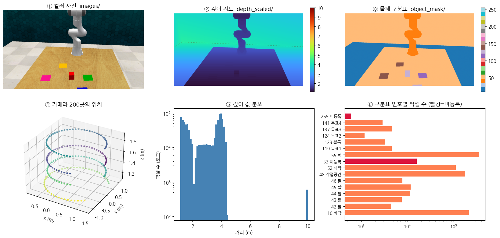
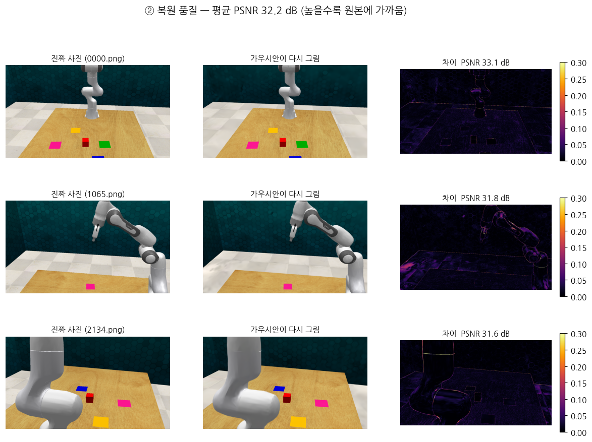
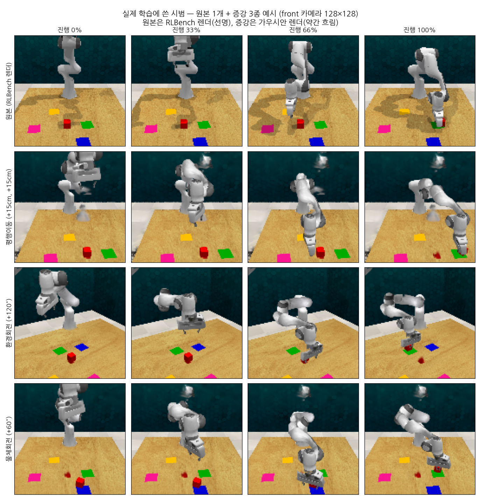
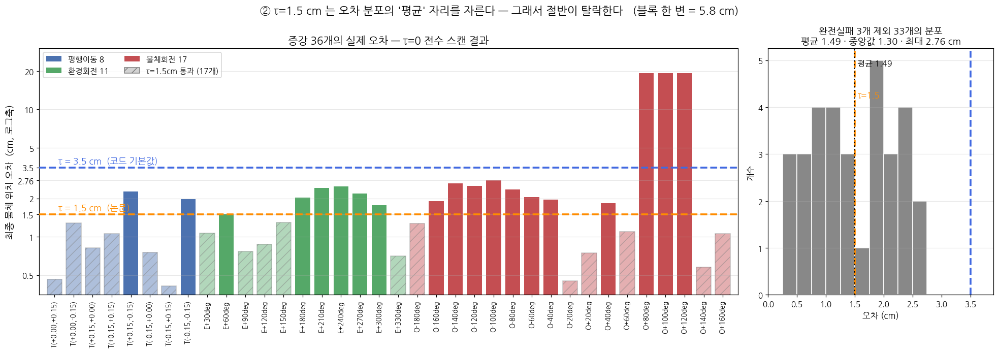
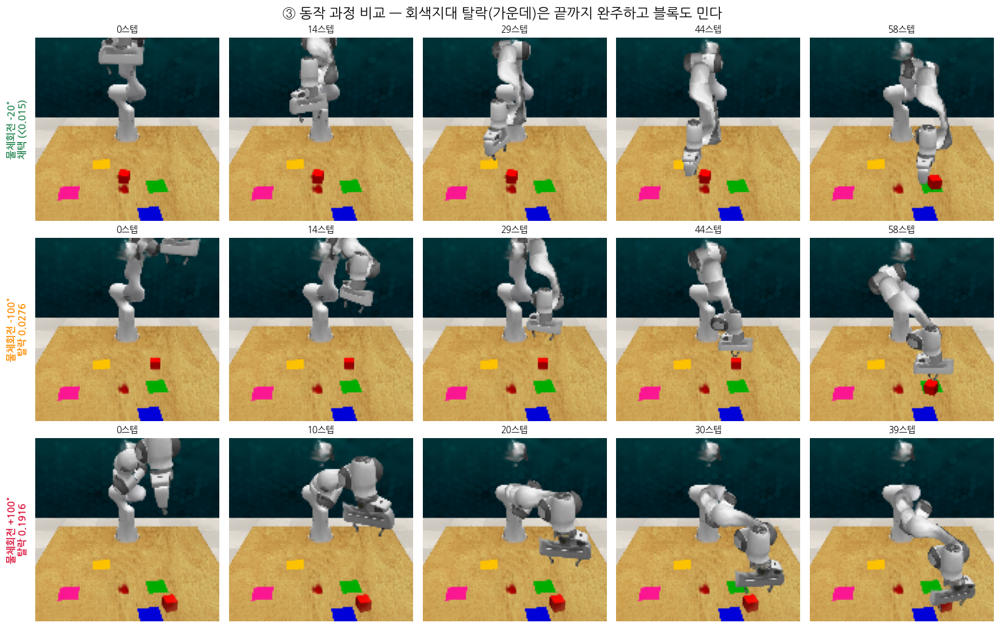
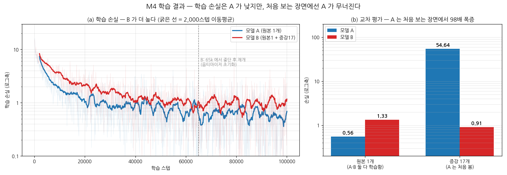
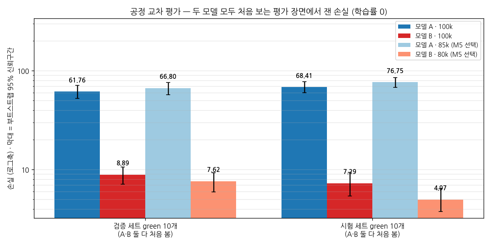
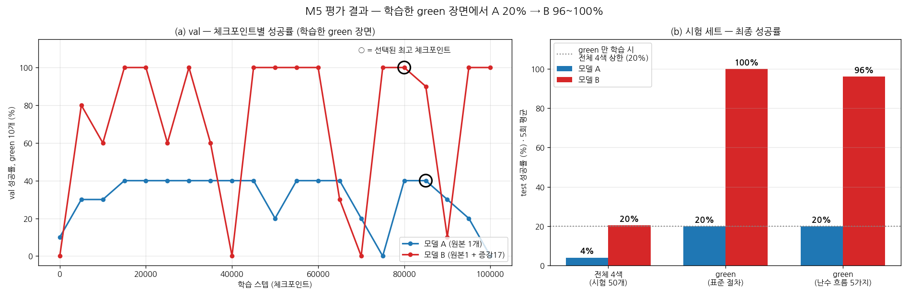

# 005. DreMa 재현 최종 보고 v2

작성: 2026-10-10
대상 논문: *Dream to Manipulate: Compositional World Models Empowering Robot Imitation Learning with Imagination* (<abbr title="국제 학습 표현 학회">ICLR</abbr> 2025)
앞 문서: `progress/004_final_report.md` (v1) · `progress/001~003` · `Data_Analysis/001~003`
상태: **재현 완료.** 과제 1개(slide_block)로 증강 → 학습 → 평가를 마쳤다.

---

## v1(004)에서 바뀐 것

| # | v1 | v2 | 이유 |
|---|---|---|---|
| ① | 교차 평가: 모델 <abbr title="모델 B, 원본 1개와 상상 17개로 학습한 실험군">B</abbr> 는 "어디서나 손실 1 근처" | **공정 교차 평가로 교체** — 두 모델 모두 처음 보는 평가 장면에서 다시 쟀다 | v1 은 <abbr title="모델 B, 원본 1개와 상상 17개로 학습한 실험군">B</abbr> 의 두 칸이 **모두 <abbr title="모델 B, 원본 1개와 상상 17개로 학습한 실험군">B</abbr> 의 학습 데이터**였다. <abbr title="모델 B, 원본 1개와 상상 17개로 학습한 실험군">B</abbr> 에겐 "처음 보는" 칸이 없었다 |
| ② | "전체 4색 46장면" 이유 없음 | 이유 추가 (§6-1) | 난수 흐름 5가지가 **공통으로 돈 장면이 4~49번 = 46개** |
| ③ | — | 증강 장면의 **붉은 얼룩**(복원 잔여물) 기록 | 그림에서 새로 확인 |
| ④ | <abbr title="모델 A, 원본 시범 1개로 학습한 대조군">A</abbr> 의 검증 green 40 % 동률 체크포인트 **14개** | **12개** | 원자료(검증 로그)로 다시 셈. 85,000 이 선택된 결과는 같다 |
| ⑤ | 성공률 차이 신뢰구간 +48 ~ +98 — 계산법 없음 | 계산법 추가 (§6-2) | green 장면 10개를 다시 뽑는 부트스트랩으로 재계산해 같은 값 확인 |

**결론은 바뀌지 않는다.** 공정하게 다시 재도 <abbr title="모델 B, 원본 1개와 상상 17개로 학습한 실험군">B</abbr> 가 <abbr title="모델 A, 원본 시범 1개로 학습한 대조군">A</abbr> 보다 약 7~15배 낮은 손실을 냈다.

---

## 한 줄 결론

> **로봇 시범 1개를 3D로 복원해 "상상한 시범" 17개를 더 만들어 학습시켰더니, 학습한 색(green)의 시험 장면에서 성공률이 20 % → 96 % 로 올랐다.**
> 두 모델 모두 **처음 보는 장면**에서 잰 값이다. 논문의 핵심 주장(*상상한 시범이 성공률을 높인다*)이 **같은 방향**으로 재현됐다.

---

## 사전지식

| 용어 | 뜻 |
|---|---|
| 모방학습 | 사람이 보여 준 시범을 보고 로봇이 따라 배우는 방법 |
| 시범 (에피소드) | 과제를 처음부터 끝까지 한 번 해낸 기록 = 카메라 사진 + 로봇 손 위치 |
| DreMa | 이 논문의 방법. 시범 장면을 3D로 복원한 뒤 물체를 옮겨 보며 새 시범을 "상상"한다 |
| 가우시안 스플래팅 | 수많은 반투명 점(가우시안)으로 3D 장면을 만들고, 어느 방향에서든 사진처럼 그려 내는 기술 |
| 렌더 | 3D 장면을 사진으로 그려 내는 것. **RLBench 렌더**(시뮬레이터가 그림, 선명) · **가우시안 렌더**(복원본이 그림, 약간 흐림) |
| 증강 | 가진 데이터를 변형해 학습 데이터를 늘리는 것 |
| τ | 상상한 시범의 검수 기준. 블록 최종 위치가 기대 위치에서 1.5 cm 안이어야 채택 |
| PerAct | 시범으로 배우는 로봇 모델. 공간을 100×100×100 칸으로 나눠 "손을 둘 칸"과 손 방향을 고른다 |
| RLBench | 로봇 과제 시뮬레이터. 평가 장면도 여기서 만든다 |
| 체크포인트 | 학습 도중 저장한 모델. 5,000 스텝마다 저장 → 모델당 21개 |
| 검증 세트 · 시험 세트 | 체크포인트 중 최고를 고르는 시험(40장면) · 최종 점수를 내는 시험(50장면). **둘 다 학습에 안 쓴 장면** |
| 손실 | 모델의 답이 시범의 정답 동작과 얼마나 다른가. **낮을수록 정확** |
| 교차 평가 | 가중치를 고정한 채(학습률 0) 정해 둔 데이터에서 손실만 재는 것 |
| 일반화 | 학습 때 **못 본** 장면에서도 잘하는 능력. 못 본 데이터로만 잴 수 있다 |
| 경로계획 | 손을 목표 자세로 옮길 팔 관절 경로를 찾는 계산. 무작위 탐색을 쓴다 |
| 성공률 | 블록을 지시한 색의 목표판 위에 올려놓은 비율 |
| 95 % 신뢰구간 | 같은 측정을 반복하면 평균이 95 % 확률로 들어올 범위. 두 구간이 안 겹치면 차이가 우연이 아니다 |
| PSNR | 복원 사진이 원본과 얼마나 같은지 나타내는 점수. 높을수록 비슷 (30 dB 이상이면 매우 양호) |
| %p | 퍼센트포인트. 두 비율의 차이 (20 % → 96 % 는 +76 %p) |
| 모델 A · 모델 B | A = 원본 시범 1개로 학습한 대조군 · B = 원본 1개 + 상상 17개로 학습한 실험군 |

---

## 1. 논문이 주장하는 것

> **[공학적 정의]** 모방학습은 시범이 많을수록 잘 되지만 사람 시범은 비싸다. DreMa 는 시범 장면을 **가우시안(겉모습) + 물리 시뮬레이터(움직임)** 로 복원한 "세계 모델"을 만들고, 그 안에서 **물체 배치를 바꿔 로봇 동작을 다시 실행**해 새 시범을 합성한다. 결과가 기대와 맞는 것(<abbr title="증강 검수 기준, 블록 최종 위치의 허용 오차 1.5cm">τ</abbr> 검수 통과)만 학습에 쓴다.
>
> **[비유]** 요리를 **한 번** 배운 뒤, 머릿속으로 "재료가 왼쪽에 있었다면?", "도마가 돌아가 있었다면?"을 상상하며 연습하는 것이다.

**과제 — slide_block_to_color_target**: 빨간 블록을 지시한 색(green·blue·pink·yellow)의 목표판 위로 **밀어서** 옮긴다. 집어 드는 과제가 아니다.

**논문 목표 수치** (Table 1, 이 과제):

| 학습 데이터 | 성공률 |
|---|---:|
| 원본 시범만 | 48.4 % |
| 상상 시범만 | 54.4 % |
| **원본 + 상상** | **62.0 %** |

→ 재현 성공의 기준: **"원본만" < "원본 + 상상"** 이 같은 방향으로 나오는 것.

---

## 2. 전체 흐름

```
 시범 1개          3D 복원            상상                  검수                학습                    평가
 사진 200장   →   가우시안 +     →   물체 배치를 36가지  →  τ = 1.5 cm    →   모델 A: 원본 1개      →  처음 보는 장면
 + 손 궤적        물리 모델           로 바꿔 다시 실행       17개 통과          모델 B: 원본 + 17개       (검증 40 · 시험 50)
```

| 단계 | 한 일 | 결과 |
|---|---|---|
| 1 · 증강 | 복원 품질 확인, 상상 시범 생성·검수 | <abbr title="복원 사진이 원본과 얼마나 같은지 나타내는 점수, 높을수록 비슷">PSNR</abbr> 32.2 dB, 36가지 중 17개 채택 |
| 2 · 환경 | 학습·평가 환경 구축(RTX 5090), 평가 데이터 31 GB 확보 | 최신 <abbr title="그래픽 처리 장치, 학습 계산에 쓰는 칩">GPU</abbr> 와 2022년 코드의 충돌 해결 |
| 4 · 학습 | 원본 시범 재실행 + 모델 <abbr title="모델 A, 원본 시범 1개로 학습한 대조군">A</abbr>·<abbr title="모델 B, 원본 1개와 상상 17개로 학습한 실험군">B</abbr> 를 같은 설정으로 학습 | 재실행 오차 0 mm, 각 10만 스텝 · 체크포인트 21개 |
| 5 · 평가 | 공정 교차 평가(손실) + 시험 세트(성공률) | 손실 <abbr title="모델 A, 원본 시범 1개로 학습한 대조군">A</abbr> 62~77 vs <abbr title="모델 B, 원본 1개와 상상 17개로 학습한 실험군">B</abbr> 5~9 · green 성공률 <abbr title="모델 A, 원본 시범 1개로 학습한 대조군">A</abbr> 20 % → <abbr title="모델 B, 원본 1개와 상상 17개로 학습한 실험군">B</abbr> 96 % |

(3단계 = 과제 9개로 확장. 흐름을 익히는 것이 목적이라 과제 1개로 줄였다.)

---

## 3. 상상한 시범 만들기 (데이터 증강)

### 3-1. 입력 — 시범 단 1개



- 카메라 200곳(④)이 장면을 **빙 둘러 찍은 사진 200장**(①) + 깊이(②) + 물체 구분표(③) + 로봇 손 궤적 90스텝
- 지시는 *"slide the block to green target"* → **green 1색뿐**이다

### 3-2. 3D 복원 — 진짜와 구분이 안 된다



왼쪽 진짜 사진, 가운데 복원본이 다시 그린 사진. 평균 <abbr title="복원 사진이 원본과 얼마나 같은지 나타내는 점수, 높을수록 비슷">PSNR</abbr> **32.2 dB**. 차이(오른쪽)는 물체 가장자리에만 얇게 남는다.
→ 복원이 정확해야 그 위에서 상상한 시범도 믿을 수 있다.

### 3-3. 증강 3종 — 실제 학습에 쓴 것




| 종류 | 무엇을 바꾸나 | 채택 / 시도 |
|---|---|---:|
| 평행이동 | 테이블·물체 전체를 로봇 기준으로 ±15 cm 밀기 | 6 / 8 |
| 환경회전 | 테이블·물체 전체를 한 점 둘레로 30° 씩 돌리기 | 5 / 11 |
| 물체회전 | 목표판·테이블은 그대로 두고, 블록과 손 궤적을 **궤적의 마지막 손 위치(블록을 다 밀어 넣은 곳) 둘레로** 20° 씩 돌리기 → 다른 방향에서 밀어 오는 시범 | 6 / 17 |

- 로봇 손 궤적도 **같은 변환**을 받는다 — "옮겨 놓은 장면에서 같은 동작을 다시 해 본다".
- 맨 윗줄 원본은 **RLBench 렌더**(선명), 아래 증강은 **가우시안 렌더**(약간 흐림)다. 평가 장면은 RLBench 렌더라, <abbr title="모델 B, 원본 1개와 상상 17개로 학습한 실험군">B</abbr> 는 **학습과 다른 그림체로 시험을 본다** (§5에서 다시 나온다).
- 증강 장면에는 **원래 블록이 있던 자리에 붉은 얼룩**이 남는다(물체회전 줄, 평행이동 줄 마지막 칸). 블록을 떼어 옮길 때 테이블 쪽에 남은 복원 잔여물로 보인다. 학습에 그대로 들어갔다.

### 3-4. 검수 — <abbr title="증강 검수 기준, 블록 최종 위치의 허용 오차 1.5cm">τ</abbr> = 1.5 cm

> **[공학적 정의]** 바꾼 장면에서 로봇 동작을 물리 시뮬레이션으로 다시 돌리면 블록이 기대한 곳으로 가지 않을 수 있다. **블록의 실제 최종 위치**가 **원래 결과를 같은 변환으로 옮긴 위치**에서 <abbr title="증강 검수 기준, 블록 최종 위치의 허용 오차 1.5cm">τ</abbr> 안일 때만 채택한다.
>
> **[비유]** 시범을 복사기로 36장 뽑고 **삐뚤어진 것은 버리는** 검수다. <abbr title="증강 검수 기준, 블록 최종 위치의 허용 오차 1.5cm">τ</abbr> 는 "얼마나 삐뚤면 버릴지"의 기준선이다.



- **논문은 <abbr title="증강 검수 기준, 블록 최종 위치의 허용 오차 1.5cm">τ</abbr> = 0.015 m, 공개 코드 기본값은 0.035 m** 로 서로 다르다 → 논문 값을 썼다.
- 근거: 채택률이 우리 **49 %**(원본 포함 18 / 37), 논문 이 과제 **41 %** 로 가깝다. 코드 기본값이면 92 % 가 돼 논문과 맞지 않는다.
- 블록 한 변이 5.8 cm 인데 1.5 cm 기준은 분포 한가운데를 자른다 → **눈으로는 성공한 시범도 꽤 버려진다.** 논문도 같은 기준을 썼다.



위: 채택(물체회전 −20°) · 가운데: 오차 2.8 cm 로 탈락(−100°) · 아래: 팔이 닿지 않아 40스텝에서 중단(+100°)


↑ 물체회전 +100° — 밀어야 할 지점에 팔이 닿지 않아 동작이 중간에 멈춘다.

---

## 4. 학습 — 모델 2개

| | 모델 <abbr title="모델 A, 원본 시범 1개로 학습한 대조군">A</abbr> (대조군) | 모델 <abbr title="모델 B, 원본 1개와 상상 17개로 학습한 실험군">B</abbr> (실험군) |
|---|---|---|
| 학습 데이터 | 원본 시범 1개 | 원본 1개 + 상상 17개 |
| 학습 표본 수 | 16개 | 186개 (11.6배) |
| 학습 데이터의 그림체 | RLBench 렌더 100 % | RLBench 렌더 1개 + 가우시안 렌더 17개 |
| 설정 | **동일** — PerAct, 배치 3, 10만 스텝, 카메라 3대(정면·왼쪽 어깨·오른쪽 어깨), 128×128 | ← |
| 학습 시간 | 약 26시간 | 약 22시간 (65,000 스텝에서 한 번 끊고 이어서) |

→ 두 모델의 설정 파일을 비교해 **데이터만 다름**을 확인했다(단 <abbr title="모델 B, 원본 1개와 상상 17개로 학습한 실험군">B</abbr> 는 65,000 스텝에서 끊었다가 이어서 학습했다). 그래서 성공률 차이를 **추가한 상상 시범의 효과**로 본다.

**원본 시범은 어떻게 준비했나** — 받은 원본에는 학습용 사진(128×128)이 없었다. 원본에 저장된 **난수 상태를 되돌려 RLBench 에서 같은 장면을 다시 실행**해 만들었다. 손 위치 오차 **0.000 mm** 로 완전히 같다.



- **(a) 학습 손실은 <abbr title="모델 A, 원본 시범 1개로 학습한 대조군">A</abbr> 가 더 낮다** (90,000~99,900 스텝 평균 <abbr title="모델 A, 원본 시범 1개로 학습한 대조군">A</abbr> 0.57 · <abbr title="모델 B, 원본 1개와 상상 17개로 학습한 실험군">B</abbr> 1.00). 시범 1개는 외우기 쉽기 때문이다.
- ⚠️ **(b) 는 공정한 비교가 아니다** → §5 의 공정 교차 평가로 대체한다.

---

## 5. 공정 교차 평가 — 두 모델 모두 처음 보는 장면에서 손실 재기

### 5-1. v1 교차 평가(위 그림 b)의 문제

| | 원본 1개 | 증강 17개 |
|---|---|---|
| 모델 <abbr title="모델 A, 원본 시범 1개로 학습한 대조군">A</abbr> | 0.56 · 학습 때 봄 | 54.64 · **처음 봄** |
| 모델 <abbr title="모델 B, 원본 1개와 상상 17개로 학습한 실험군">B</abbr> | 1.33 · 학습 때 봄 | 0.91 · 학습 때 봄 |

- 코드로 확인했다: "증강 17개"는 <abbr title="모델 B, 원본 1개와 상상 17개로 학습한 실험군">B</abbr> 학습 폴더 episode1~17 로 가는 **바로가기**다 (`81_cross_eval.sh`).
- → <abbr title="모델 B, 원본 1개와 상상 17개로 학습한 실험군">B</abbr> 의 두 숫자는 **외운 정도**이지 일반화가 아니다. <abbr title="모델 A, 원본 시범 1개로 학습한 대조군">A</abbr> 만 시험을 보고 <abbr title="모델 B, 원본 1개와 상상 17개로 학습한 실험군">B</abbr> 는 연습문제를 다시 푼 셈이다.
- 이 실험의 원래 목적은 **"<abbr title="모델 B, 원본 1개와 상상 17개로 학습한 실험군">B</abbr> 의 학습 손실이 높은 게 버그인가"** 를 가리는 것이었다. 그 목적에는 맞다(<abbr title="모델 B, 원본 1개와 상상 17개로 학습한 실험군">B</abbr> 가 증강 17개를 0.91 까지 맞힘 → 증강 라벨끼리 모순이 없다). 일반화의 근거로는 쓸 수 없다.

### 5-2. 다시 잰 방법

| | 내용 |
|---|---|
| 데이터 | 평가 세트의 **green 장면만**: 검증 10개 · 시험 10개. **<abbr title="모델 A, 원본 시범 1개로 학습한 대조군">A</abbr>·<abbr title="모델 B, 원본 1개와 상상 17개로 학습한 실험군">B</abbr> 둘 다 학습에 안 썼다** |
| 겹침 확인 | 20장면 모두 학습 원본의 첫 화면과 다르다 (픽셀 평균 차이 7 이상, 같은 장면이면 0) |
| 측정 | v1 과 같음 — 가중치 고정(학습률 0), 300 스텝, 학습 때와 같은 무작위 변형 |
| 체크포인트 | 마지막(100,000 스텝) + §6 에서 고른 최고(<abbr title="모델 A, 원본 시범 1개로 학습한 대조군">A</abbr> 85,000 · <abbr title="모델 B, 원본 1개와 상상 17개로 학습한 실험군">B</abbr> 80,000 스텝) |

### 5-3. 결과



| 모델 · 체크포인트 | 검증 green | 시험 green | 그중 회전 손실 (검증 / 시험) |
|---|---:|---:|---:|
| <abbr title="모델 A, 원본 시범 1개로 학습한 대조군">A</abbr> · 100,000 | 61.8 [52.3 ~ 71.0] | 68.4 [59.9 ~ 77.3] | 40.6 / 45.4 |
| **<abbr title="모델 B, 원본 1개와 상상 17개로 학습한 실험군">B</abbr> · 100,000** | **8.9** [7.1 ~ 10.6] | **7.3** [5.4 ~ 9.4] | 2.9 / 2.2 |
| <abbr title="모델 A, 원본 시범 1개로 학습한 대조군">A</abbr> · 85,000 (최고) | 66.8 [57.3 ~ 76.0] | 76.7 [68.2 ~ 84.9] | 45.4 / 49.7 |
| **<abbr title="모델 B, 원본 1개와 상상 17개로 학습한 실험군">B</abbr> · 80,000 (최고)** | **7.6** [6.0 ~ 9.3] | **5.0** [3.8 ~ 6.4] | 2.7 / 2.2 |

[ ] = 95 % 신뢰구간. **네 비교 모두 구간이 겹치지 않는다.**

**해석 4가지**

1. **공정하게 재도 <abbr title="모델 B, 원본 1개와 상상 17개로 학습한 실험군">B</abbr> 가 훨씬 정확하다.** <abbr title="모델 A, 원본 시범 1개로 학습한 대조군">A</abbr> 의 손실이 <abbr title="모델 B, 원본 1개와 상상 17개로 학습한 실험군">B</abbr> 의 약 7~15배다.
2. **<abbr title="모델 A, 원본 시범 1개로 학습한 대조군">A</abbr> 의 실패 원인은 "장면이 바뀐 것"이다.** 이번 평가 장면은 <abbr title="모델 A, 원본 시범 1개로 학습한 대조군">A</abbr> 가 배운 것과 **같은 RLBench 렌더**다. 그림체가 같은데도 <abbr title="모델 A, 원본 시범 1개로 학습한 대조군">A</abbr> 의 손실은 0.56 → 62~77 로 폭증한다. 차이는 대부분 **회전 손실**(<abbr title="모델 A, 원본 시범 1개로 학습한 대조군">A</abbr> 41~50 vs <abbr title="모델 B, 원본 1개와 상상 17개로 학습한 실험군">B</abbr> 2~3)에서 나온다 → 새 장면에서 손을 어느 방향으로 둘지 모른다.
   (v1 의 54.64 는 "장면 변화 + 그림체 변화"가 섞여 원인을 나눌 수 없었다.)
3. **<abbr title="모델 B, 원본 1개와 상상 17개로 학습한 실험군">B</abbr> 도 처음 보는 장면에선 나빠진다.** 학습 데이터 0.9~1.3 → 처음 본 장면 7.3~8.9 (100,000 스텝 기준). v1 그림은 이 점을 가렸다.
4. **<abbr title="모델 B, 원본 1개와 상상 17개로 학습한 실험군">B</abbr> 가 불리한 조건에서 이겼다.** <abbr title="모델 B, 원본 1개와 상상 17개로 학습한 실험군">B</abbr> 는 주로 가우시안 렌더로 배웠는데 시험은 RLBench 렌더다. 그런데도 <abbr title="모델 A, 원본 시범 1개로 학습한 대조군">A</abbr> 보다 훨씬 낫다.

> **[공학적 정의]** 학습에 쓴 데이터로 잰 손실은 **적합도**, 처음 보는 데이터로 잰 손실만이 **일반화**의 추정치다. 두 모델을 비교하려면 **둘 다에게 처음 보는** 데이터를 써야 한다.
>
> **[비유]** v1 은 학생 <abbr title="모델 A, 원본 시범 1개로 학습한 대조군">A</abbr> 에겐 새 시험지를, 학생 <abbr title="모델 B, 원본 1개와 상상 17개로 학습한 실험군">B</abbr> 에겐 풀어 본 문제집을 준 것이다. v2 는 **둘에게 같은 새 시험지**를 줬다.

---

## 6. 평가 결과 — 성공률

### 6-1. 절차

- 논문과 같다: 검증 세트 40장면으로 체크포인트 21개를 모두 평가 → 가장 높은 것을 고름 → 그것으로 시험 세트 50장면 평가.
- 평가 장면은 DreMa 저자가 공개한 RLBench 장면이며 **4색이 섞여 있다**(시험 50장면 중 green 10장면). 그래서 **green 만**과 **전체 4색** 두 가지로 집계했다.
- 표준 절차의 "5회 반복"이 사실상 같은 실행이었다(§6-4). 그래서 **시작 장면을 0·1·2·3·4번으로 바꾼 실행 5개**(= 난수 흐름 5가지)로 다시 쟀다.
  - 시작 장면이 K 이면 장면 K~49 를 돈다 → 다섯 실행이 **공통으로 돈 장면은 4~49번 = 46개**. 그래서 전체 4색을 46장면 × 5 = 230회로 집계했다.
  - green 10장면(16·22·29·32·34·38·40·41·43·45번)은 모두 4번 이후라 **빠짐없이 들어간다** → 10 × 5 = 50회.

### 6-2. 성공률



| | 모델 <abbr title="모델 A, 원본 시범 1개로 학습한 대조군">A</abbr> | 모델 <abbr title="모델 B, 원본 1개와 상상 17개로 학습한 실험군">B</abbr> | 차이 |
|---|---:|---:|---:|
| 선택된 체크포인트 (검증 세트 기준) | 85,000 스텝 | 80,000 스텝 | |
| **green — 학습한 색** (10장면 × 5 = 50회) | **20 %** (10/50) | **96 %** (48/50) | **+76 <abbr title="퍼센트포인트, 두 비율의 차이">%p</abbr>** (95 % 신뢰구간 +48 ~ +98) |
| 전체 4색 (46장면 × 5 = 230회) | 4.3 % (10/230) | 21.7 % (50/230) | +17 <abbr title="퍼센트포인트, 두 비율의 차이">%p</abbr> |
| 학습 안 한 3색 (36장면 × 5) | 0 / 180 | 2 / 180 | |

- 신뢰구간 +48 ~ +98 <abbr title="퍼센트포인트, 두 비율의 차이">%p</abbr>: green 장면 10개를 **장면 단위로 다시 뽑는 부트스트랩**(10만 번)으로 냈다. 장면마다 성공률이 갈리므로(예: <abbr title="모델 A, 원본 시범 1개로 학습한 대조군">A</abbr> 는 2장면만 5/5) 회차 50번이 아니라 **장면 10개**를 표본으로 본 것이다.
- 표준 절차 그대로 재면 green <abbr title="모델 A, 원본 시범 1개로 학습한 대조군">A</abbr> 20 % · <abbr title="모델 B, 원본 1개와 상상 17개로 학습한 실험군">B</abbr> 100 %, 전체 4색(50장면) <abbr title="모델 A, 원본 시범 1개로 학습한 대조군">A</abbr> 4.0 % · <abbr title="모델 B, 원본 1개와 상상 17개로 학습한 실험군">B</abbr> 20.4 % 다 (그림 b 의 왼쪽·가운데 막대).
- **<abbr title="모델 A, 원본 시범 1개로 학습한 대조군">A</abbr> 는 green 10장면 중 늘 같은 2장면만 성공**한다. <abbr title="모델 B, 원본 1개와 상상 17개로 학습한 실험군">B</abbr> 는 10장면 모두 대부분 성공한다.
- 그림 (a): <abbr title="모델 B, 원본 1개와 상상 17개로 학습한 실험군">B</abbr> 는 체크포인트 21개 중 11개에서 검증 green 100 % 지만, **0 %(40,000·70,000) · 10 %(90,000) · 30 %(65,000)로 떨어지는 것도 있다** → 검증 세트로 고르는 절차가 중요했다.
- 성공률이 같으면 가장 뒤쪽 체크포인트를 고른다. <abbr title="모델 A, 원본 시범 1개로 학습한 대조군">A</abbr> 는 12개가 검증 green 40 % 로 같아 85,000 이 선택됐다 (시험에서는 20 %).
- §5 의 손실 결과와 **방향이 같다** — 손실로 봐도, 성공률로 봐도 <abbr title="모델 B, 원본 1개와 상상 17개로 학습한 실험군">B</abbr> 가 처음 보는 장면에서 낫다.

### 6-3. 영상으로 보기

**같은 장면, 두 모델** — green 시험 장면 29


<abbr title="모델 A, 원본 시범 1개로 학습한 대조군">A</abbr> 는 블록 근처까지 가지만 목표판에 올리지 못하고, <abbr title="모델 B, 원본 1개와 상상 17개로 학습한 실험군">B</abbr> 는 green 목표판 위에 올린다. <abbr title="모델 A, 원본 시범 1개로 학습한 대조군">A</abbr> 는 이 장면을 어떤 실행 조건에서도 실패했고, <abbr title="모델 B, 원본 1개와 상상 17개로 학습한 실험군">B</abbr> 는 긴 연속 실행에서 7번 모두 성공했다. ([발표용 영상](../videos/20261002_2207_004_rollout_ab_ep29.mp4))

**색을 바꾸면 — 배우지 않은 것은 못 한다**


모델 <abbr title="모델 B, 원본 1개와 상상 17개로 학습한 실험군">B</abbr> 에게 *"pink 목표로 밀어라"* 를 시켰다. pink 가 아니라 **늘 하던 green 쪽으로** 민다. 두 모델 모두 green 만 배웠기 때문이다. ([발표용 영상](../videos/20261002_2123_004_rollout_b_pink.mp4))

### 6-4. 주의 — 같은 장면도 결과가 바뀔 수 있다

> **[공학적 정의]** RLBench 는 팔 경로를 찾을 때 **무작위 탐색 + 10 ms 시간 제한**을 쓴다(`arm_action_modes.py`, `max_time_ms=10`). 그래서 **같은 모델·같은 장면이라도 실행 이력(앞서 몇 번 계획했는지)에 따라** 다른 경로가 나와 성공·실패가 갈릴 수 있다. 컴퓨터 속도도 영향을 줄 것으로 추정하지만, 시간 제한을 바꿔 보는 실험은 하지 않았다.
>
> **[비유]** "10초 안에 꾸러미에서 맞는 열쇠를 찾아라" 시험이다. 같은 꾸러미라도 **어떤 순서로 집어 보았는지**에 따라 결과가 다르다.

| 발견 | 내용 | 대응 |
|---|---|---|
| ① 반복이 반복이 아니었다 | 표준 절차의 5회 반복이 **매번 같은 순서**로 돌았다. <abbr title="모델 A, 원본 시범 1개로 학습한 대조군">A</abbr> 는 5회의 성공·실패가 장면마다 똑같았고 <abbr title="모델 B, 원본 1개와 상상 17개로 학습한 실험군">B</abbr> 도 50장면 중 1장면만 달랐다 | 시작 장면을 0~4 로 바꿔 **난수 흐름 5가지**로 다시 쟀다 → <abbr title="모델 B, 원본 1개와 상상 17개로 학습한 실험군">B</abbr> 의 green 100 % → **96 %** |
| ② 짧은 실행에서 실패가 잦았다 | 새 실행의 첫 장면이나 짧은 실행에서 <abbr title="모델 B, 원본 1개와 상상 17개로 학습한 실험군">B</abbr> 가 자주 실패했다 (장면 29: 짧은 실행 3/3 실패, 긴 연속 실행 7/7 성공 · 장면 16: 짧은 실행 2/2 실패). 표본이 적어 원인은 확정하지 못했다 | 평가 수치는 전부 **긴 연속 실행**에서 나왔고, 각 실행의 첫 장면(0~4번)은 모두 학습 안 한 색(pink·yellow)이었다 → green 수치에 직접 들어가지 않았다 |


↑ 모델 <abbr title="모델 B, 원본 1개와 상상 17개로 학습한 실험군">B</abbr> · green 장면 16 — **같은 모델·같은 장면**인데 첫 장면으로 돌리면 실패(왼쪽), 다른 장면 6개 뒤에 돌리면 성공(오른쪽)한다. 긴 실행에서도 7번 중 5번만 성공한 경계 장면이다. ([발표용 영상](../videos/20261002_2152_004_rollout_b16_fail_vs_succ.mp4))

### 6-5. 논문과 비교

| | 원본만 | 원본 + 상상 |
|---|---:|---:|
| 논문 (4색 학습 · 원본 4개) | 48.4 % | 62.0 % |
| 우리 · 전체 4색 (green 1색 학습 · 원본 1개) | 4.3 % | 21.7 % |
| 우리 · green 만 | 20 % | 96 % |

→ **방향(원본만 < 원본 + 상상)이 재현됐다.**
전체 4색의 절대값이 낮은 이유: 시험 장면의 약 80 % 가 **학습하지 않은 색**이고, 그 색은 두 모델 모두 사실상 0 % 다 → 전체 4색 성공률은 **green 장면 비율(46장면 중 10개 ≈ 22 %)이 사실상 상한**이다. <abbr title="모델 B, 원본 1개와 상상 17개로 학습한 실험군">B</abbr>(21.7 %)는 그 상한에 거의 닿았다 — green 2번 실패와 다른 색 2번 성공이 상쇄됐다.

---

## 7. 논문과 다른 점

| # | 항목 | 논문 | 우리 | 영향 |
|---|---|---|---|---|
| 1 | 원본 시범 | 4개 (4색) | **1개 (green)** | **가장 큼.** 학습 데이터 65개 → 18개 (28 %) |
| 2 | 과제 수 | 9개 | **1개** | 축소판 계획 (흐름 체득이 목적) |
| 3 | 배치 크기 | 4 | **3** | <abbr title="그래픽 처리 장치, 학습 계산에 쓰는 칩">GPU</abbr> 메모리 부족 (논문 A40 48 GB, 우리 RTX 5090 32 GB). 저자 기록상 이 과제는 배치 영향이 작다 |
| 4 | 깊이 잡음 필터 | radius outlier (3D 판단) | Scharr (2D 판단, 코드 기본값) | 포인트클라우드가 약간 다름. 논문 방식은 계산이 33시간이라 포기 |

→ 모두 의도한 차이다. 1·2번은 분명히 수치를 **낮추는 쪽**이고, 3·4번이 어느 쪽으로 작용하는지는 확인하지 못했다.

---

## 8. 재현하며 발견한 것 — 다시 해 볼 사람을 위해

| 분류 | 발견 | 대응 |
|---|---|---|
| 논문 ↔ 코드 | <abbr title="증강 검수 기준, 블록 최종 위치의 허용 오차 1.5cm">τ</abbr>: 논문 0.015 m ≠ 코드 기본값 0.035 m | 논문 값 사용 |
| 논문 ↔ 코드 | 깊이 필터: 논문 radius outlier ≠ 코드 기본값 Scharr | Scharr 유지 (비용) |
| DreMa 코드 | 증강할 때 관절 각도·손목 카메라 위치는 변환되지 않는다 | 관절 각도는 PerAct 가 안 읽고, 손목 카메라는 우리가 안 써서 무해 |
| DreMa 결과물 | 증강 장면에 원래 블록 자리의 붉은 얼룩이 남는다 | 그대로 학습. 영향은 측정하지 않음 |
| 데이터 | 원본 시범에 학습용 사진이 없다 | 저장된 난수로 장면 재실행. **수집 당시 콜백이 돌린 추가 물리 스텝까지 똑같이** 해야 오차 0 mm (처음엔 빠뜨려 2.56 mm) |
| 환경 | DreMa 가 쓰는 RLBench 판본은 PerAct 학습에 못 쓴다 | 학습·평가만 PerAct 판본 사용 (두 판본의 과제 정의는 파일 단위로 동일 확인) |
| 환경 | RTX 5090 → 최신 torch·numpy 가 강제돼 2022년 부품과 충돌 | pandas 업그레이드, pyrender 1줄 보정 |
| 평가 | 배치 3 으로 학습한 모델을 배치 1 로 평가하면 격자 모양이 안 맞아 로드 실패 | 학습되지 않는 고정 격자는 빼고 로드 (학습 전후 값이 같음을 확인) |
| 평가 | 컨테이너 공유 메모리 64 MB → 평가 프로세스가 죽는다 | 자식 프로세스 없이 직접 실행 |
| 평가 | 경로계획 무작위성 · 실행 이력 의존 (§6-4) | 난수 흐름 5가지로 재측정 |
| **분석** | **v1 교차 평가에서 <abbr title="모델 B, 원본 1개와 상상 17개로 학습한 실험군">B</abbr> 의 두 칸이 모두 <abbr title="모델 B, 원본 1개와 상상 17개로 학습한 실험군">B</abbr> 학습 데이터였다** (§5-1) | **두 모델 모두 처음 보는 평가 장면으로 다시 측정** |

---

## 9. 한계

| | 내용 |
|---|---|
| 표본이 작다 | green 시험 장면이 **10개**뿐 → 성공률 차이의 신뢰구간이 +48 ~ +98 <abbr title="퍼센트포인트, 두 비율의 차이">%p</abbr> 로 넓다. 방향은 확실하지만 **정확한 크기는 불확실** |
| 손실 신뢰구간의 범위 | §5 의 구간은 300 스텝 중 30개 기록으로 낸 것이라 **무작위 배치의 흔들림**만 반영한다. "장면이 10개뿐"이라는 불확실성은 담지 못한다 |
| 손실 ≠ 성공률 | 손실은 핵심 동작을 얼마나 맞히는지다. 실제 성공 여부는 §6 성공률로 봐야 한다 |
| 조건이 좁다 | 과제 1개 · 원본 1개 · 색 1개. 논문 조건의 일부만 재현했다 |
| 체크포인트 편차 | <abbr title="모델 B, 원본 1개와 상상 17개로 학습한 실험군">B</abbr> 는 체크포인트마다 성공률이 크게 흔들린다 (100 % ↔ 0 %) |
| 대조군 부족 | 원본을 복제해 개수만 18개로 맞춘 모델은 학습하지 않았다 → 효과가 "시범 수" 때문인지 "상상으로 생긴 다양성" 때문인지 완전히 나누지 못했다 |
| 하지 않은 것 | 실제 로봇 실험 (논문 Table 4) |

---

## 10. 파일 위치

| 무엇 | 경로 |
|---|---|
| 학습 데이터 | `data/m4_train/A_original_only/` · `data/m4_train/B_original_plus_aug17/` (출처표 `data/m4_train/provenance.txt`) |
| 상상 시범 원본 | `data/aug_tau015_paper/` |
| 모델 (각 21개) | `logs/dremaA_orig/PERACT_BC/seed0/weights/` · `logs/dremaB_all/PERACT_BC/seed0/weights/` |
| 성공률 평가 결과 | 위 폴더의 `eval_data.csv`(검증) · `test_data_rep1~5.csv`(시험) · 난수 흐름 재측정 `logs_robust/` |
| 성공률 평가 로그 | `run_logs/20260925_2129_m5_*` · `run_logs/20261002_2055_m5r_*` |
| v1 교차 평가 | `_setup/peract/81_cross_eval.sh` · `logs_crosseval/` · `run_logs/20260925_1940_m4_crosseval.log` |
| **공정 교차 평가** | `_setup/peract/82_cross_eval_fair.sh` · `logs_crosseval_fair/` · 장면 출처 `data/m4_crosseval_fair/provenance.txt` |
| 공정 교차 평가 로그 | `run_logs/20261010_2239_m4_crosseval_fair.log` · 집계 `run_logs/20261010_2310_crosseval_fair_summary.log` (`_setup/summarize_crosseval_fair.py`) |
| 실행 스크립트 | `_setup/peract/70_train.sh`(학습) · `92_eval_m5.sh`(평가) · `95_eval_robust.sh`(재측정) |
| 발표용 영상 | `_thinking/videos/` 의 `*_004_rollout_*.mp4` |

---

## 요약

| 질문 | 답 |
|---|---|
| **무엇을** 재현했나 | DreMa 의 핵심 주장 — *시범 1개를 3D로 복원하고 물체 배치를 바꿔 상상한 시범으로 학습하면 성공률이 오른다* — 를 slide_block 과제 1개로 |
| **어떻게** | 시범 1개 → 가우시안 복원(<abbr title="복원 사진이 원본과 얼마나 같은지 나타내는 점수, 높을수록 비슷">PSNR</abbr> 32.2 dB) → 36가지로 바꿔 보기 → <abbr title="증강 검수 기준, 블록 최종 위치의 허용 오차 1.5cm">τ</abbr> = 1.5 cm 로 17개 채택 → <abbr title="모델 A, 원본 시범 1개로 학습한 대조군">A</abbr>(원본 1개) / <abbr title="모델 B, 원본 1개와 상상 17개로 학습한 실험군">B</abbr>(원본 + 17개)를 **데이터만 다르게** 10만 스텝씩 학습 |
| 손실 (둘 다 처음 보는 green 장면 20개) | <abbr title="모델 A, 원본 시범 1개로 학습한 대조군">A</abbr> **62~77** vs <abbr title="모델 B, 원본 1개와 상상 17개로 학습한 실험군">B</abbr> **5~9** → 약 7~15배 차이, 95 % 신뢰구간 겹치지 않음 |
| 성공률 · green (시험 10장면 × 5) | <abbr title="모델 A, 원본 시범 1개로 학습한 대조군">A</abbr> **20 %** → <abbr title="모델 B, 원본 1개와 상상 17개로 학습한 실험군">B</abbr> **96 %** (+76 <abbr title="퍼센트포인트, 두 비율의 차이">%p</abbr>, 95 % 신뢰구간 +48 ~ +98) |
| 성공률 · 전체 4색 (46장면 × 5) | <abbr title="모델 A, 원본 시범 1개로 학습한 대조군">A</abbr> 4.3 % → <abbr title="모델 B, 원본 1개와 상상 17개로 학습한 실험군">B</abbr> 21.7 % (상한 약 22 %) |
| 논문과 같은가 | **방향이 같다** (논문 48.4 % → 62.0 %). 절대값이 낮은 것은 green 1색만 학습했기 때문 |
| v1 에서 바로잡은 것 | v1 교차 평가는 <abbr title="모델 B, 원본 1개와 상상 17개로 학습한 실험군">B</abbr> 에게 학습 데이터를 준 **불공정 비교**였다 → 공정하게 다시 재도 결론 유지 |
| 주의할 것 | green 시험 장면 10개뿐 → 효과의 **정확한 크기는 불확실** · 경로계획 무작위성 → 난수 흐름 5가지로 측정 · "시범 수" 효과와 "다양성" 효과는 분리 못 함 |
